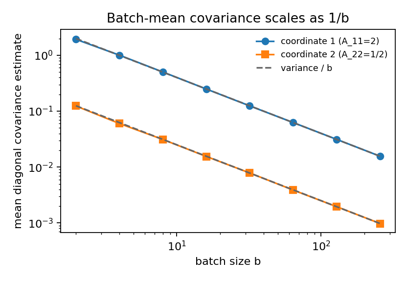
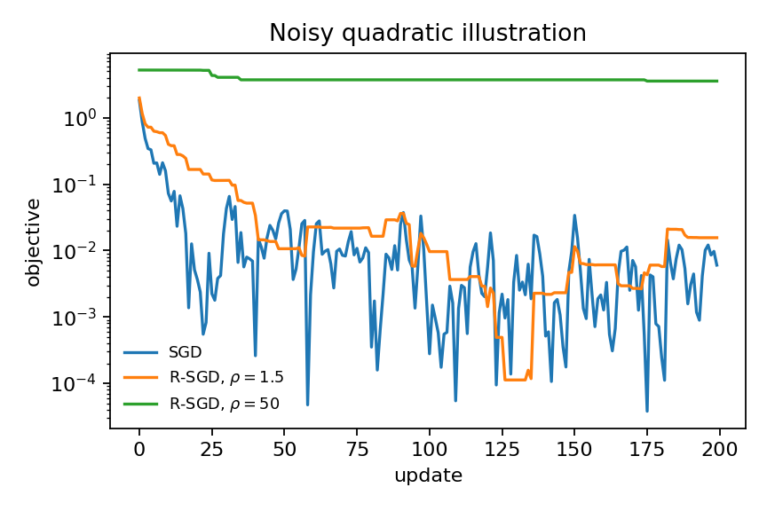
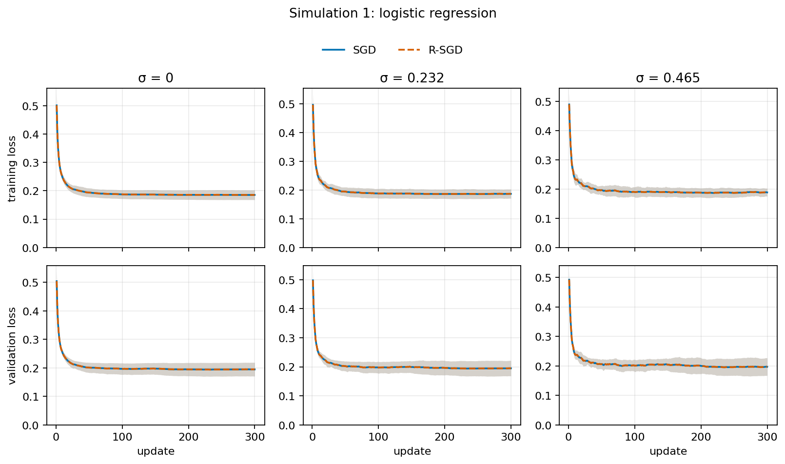
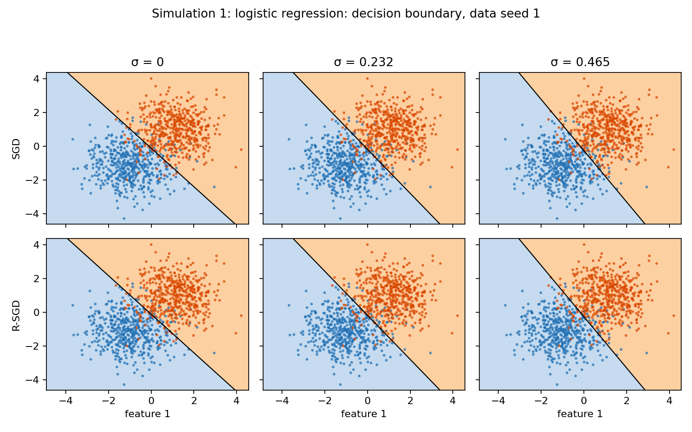
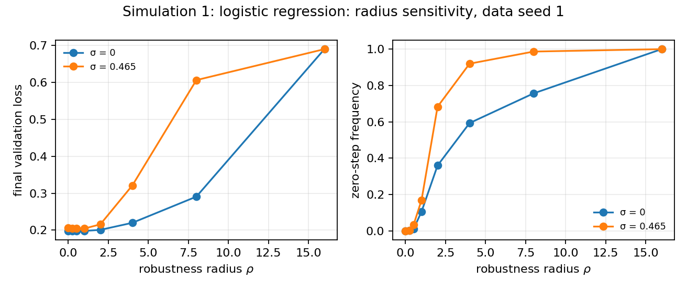
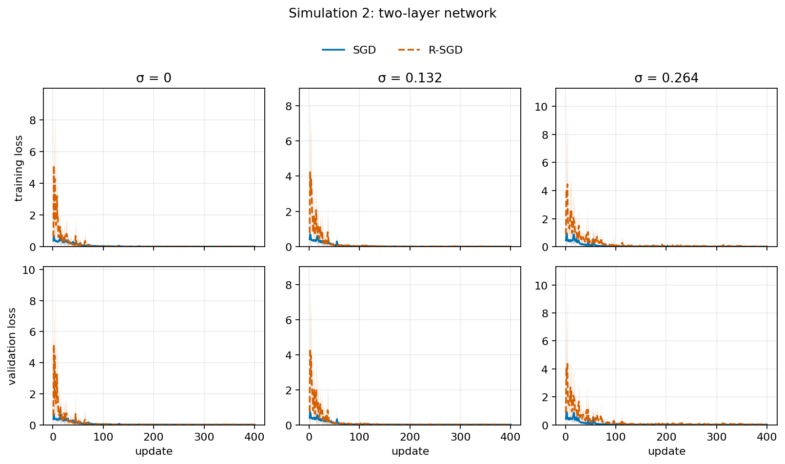
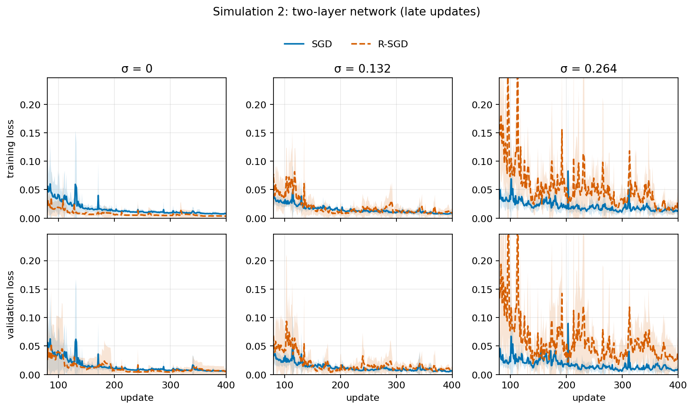
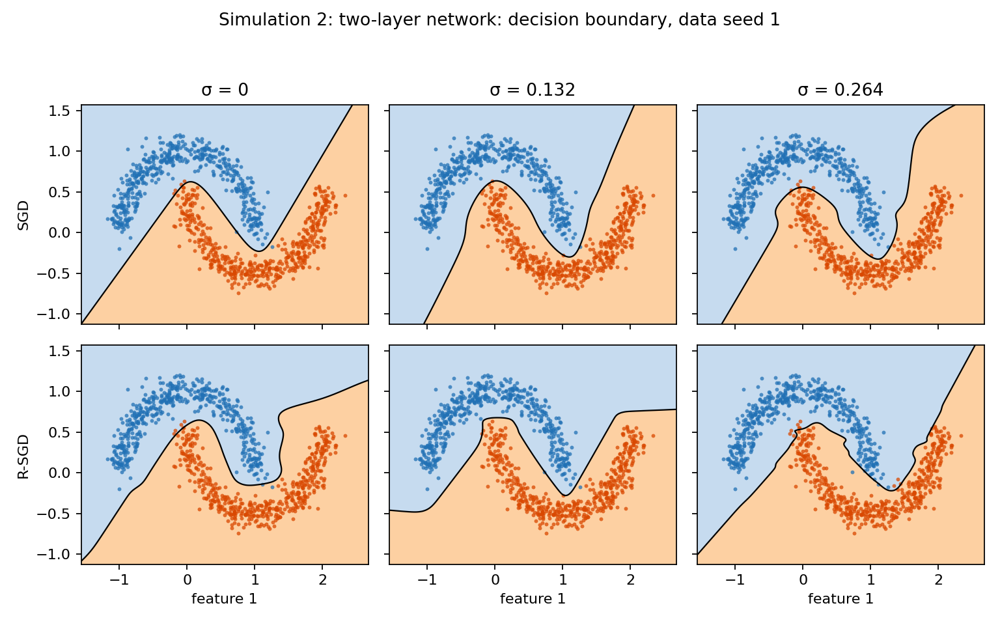
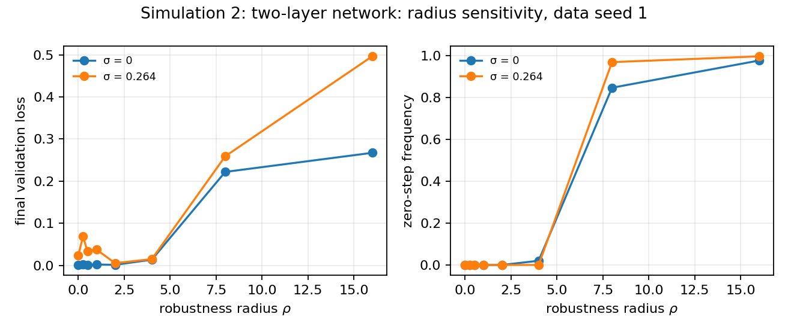

# SGD versus robust SGD under gradient uncertainty

Practical part: implementation, numerical checks, and the two required simulations. The derivation in Section 1 of the assignment is assumed and is not repeated. Fill in your name before submission.

```bash
python checks.py
python experiments.py
```

Dependencies are pinned in `requirements.txt` (NumPy 1.26, SciPy 1.17, Matplotlib 3.8). Everything below is produced by those two commands. Raw numbers are in `results/checks.json` and `results/summary.json`.

## 1. Implementation

Both methods minimize the mean training loss. There is no weight decay. The loss is binary cross-entropy from the logit,

```text
ℓ(t, y) = log(1 + eᵗ) − y·t
```

evaluated as a stable softplus. A point is classified as class 1 when t ≥ 0.

An update draws a minibatch of size b = 32 independently with replacement and builds one gradient observation per draw. Artificial noise is added only to those observations,

```text
vₖᵢ = uᵢ(θₖ) + σ·zₖᵢ,    zₖᵢ ~ N(0, Iₚ)
```

The training objective, the labels, and the validation and test sets are never corrupted. The batch mean gₖ and the diagonal covariance of that mean follow the assignment:

```text
ŝₖⱼ = 1/(b(b−1)) · Σᵢ (vₖᵢⱼ − gₖⱼ)²
εₖ  = 10⁻³ · max{ (1/p)·Σⱼ ŝₖⱼ , 10⁻⁸ }
sₖⱼ = ŝₖⱼ + εₖ
```

SGD takes dₖ = −αₖ gₖ. R-SGD solves

```text
dₖ = argmin over d of   gₖᵀd + ρ·√(dᵀSₖd) + ‖d‖² / (2αₖ),    Sₖ = diag(sₖ)
```

The objective is strongly convex, so the step is unique. It is dₖ = 0 when gₖᵀ Sₖ⁻¹gₖ ≤ ρ², which includes gₖ = 0. Otherwise stationarity,

```text
gₖ + ρ·Sₖdₖ / √(dₖᵀSₖdₖ) + dₖ/αₖ = 0
```

reduces to one scalar unknown t = ρ/√(dᵀ S d) > 0,

```text
Σⱼ  sⱼ·gⱼ²·t² / (1/α + t·sⱼ)²  =  ρ²
```

The left side is strictly increasing from 0 to gᵀ S⁻¹g. Bisection finds the root and recovers dⱼ = −gⱼ/(1/α+t sⱼ). The bracket stops at relative width 10⁻¹², with at most 80 bisections, so a step costs O(p log(1/tol)). When ρ = 0 the code returns −α g and does not run bisection. Each trial is a few dozen operations at p ≤ 33, which is why the extra cost shows up as Python overhead rather than as extra gradient evaluations.

Gradients are analytic. Logistic regression has parameters (w,c) ∈ ℝ² × ℝ and per-example gradient (σ(t)−y) (a,1). The network is

```text
t(a) = w₂ᵀ·tanh(W₁a + b₁) + b₂,    W₁ ∈ ℝ^(8×2),  b₁, w₂ ∈ ℝ⁸,  b₂ ∈ ℝ
```

(33 parameters). Its gradient is the usual backpropagation through tanh.

## 2. Numerical checks

Central differences on the mean loss agree with the averaged analytic gradients to relative error 3.3 × 10⁻¹⁰ (logistic) and 6.9 × 10⁻¹⁰ (network).

On 25 random diagonal problems the solver matches three independent facts:

- ρ = 0 reproduces −α g exactly;
- for S = sI the step matches d = −α(1−ρ√s/‖g‖)₊ g, including the zero step when g = 0 or ‖g‖ ≤ ρ√s, with absolute error at most 5.5 × 10⁻¹²;
- the stationarity residual on every nonzero step is at most 7.6 × 10⁻¹³ relative to ‖g‖.

L-BFGS-B started at the origin never found a lower value of the robust objective than the bisection step (gap 0 on these trials). A full logistic run with ρ = 0 produces the same parameters and the same loss trajectory as SGD, bit for bit, when the initialization, minibatch indices, and noise draws match.

The covariance check uses the assignment's noisy quadratic, ∇ f(θ) = (θ₁,4θ₂) plus noise σ A z with A = diag(2,1/2) and σ = 1, at θ = (2,2). The estimator ŝⱼ has expectation σ² Aⱼⱼ²/b. Over batch sizes 2 through 256 the log-log slope is −0.997 and −0.996. A larger batch therefore makes Sₖ smaller, ‖Sₖ^(−1/2)gₖ‖ larger, and a fixed radius less willing to shrink or zero the step.



The same quadratic, started at (2,2) with f = 10, is a useful zero-step illustration and is not a third simulation. With b = 16, α₀ = 0.2 and σ = 1, SGD finishes at objective 0.006. R-SGD at ρ = 1.5 finishes at 0.016 and takes a zero step on 53.5% of updates. At ρ = 50 the zero-step frequency is 96.5% and the objective only falls to 3.57: the uncertainty set still contains the origin, so the method stalls away from the minimizer.



## 3. Protocol

Both simulations use balanced samples of 1000 training, 500 validation, and 1000 test points. Features are standardized with the training mean and standard deviation; that transform is not fit on validation or test data. The learning-rate family is the same for both methods,

```text
αₖ = α₀ / √(1 + k/50)
```

Logistic regression runs for 300 updates and the network for 400. Each run therefore evaluates 300 × 32 = 9600 or 400 × 32 = 12800 per-example gradients. R-SGD does not use extra gradients. No run diverged or produced a non-finite loss.

Noise levels are set from the median per-example gradient norm at the tuning initialization, call it m. The three levels make the RMS norm of σ z, which is σ√p, equal to 0, m/2, and m:

| model | median gradient norm m | p | sigma |
| --- | ---: | ---: | --- |
| logistic | 0.805 | 3 | 0, 0.232, 0.465 |
| network | 1.517 | 33 | 0, 0.132, 0.264 |

Hyperparameters are chosen on one dataset (data seed 0, initialization seed 1000, training seed 2000) at the middle noise level, by the mean validation loss over the last 20 updates. Test labels are not used. On a tie the smaller radius wins, then the smaller α₀. The logistic grid is α₀ ∈ {0.03,0.1,0.3,1,3,10} and ρ ∈ {0,0.1,0.2,0.5,1,2,4,8} (54 runs). The network grid is α₀ ∈ {1,3,6,9,12,15,21,27} and ρ ∈ {0,0.25,0.5,1,2,4} (56 runs). A coarser network grid that stopped at α₀ = 9 had selected that endpoint, so the search was widened until the chosen values sat in the interior. They do: logistic α₀ = 1 is between 0.3 and 3; network α₀ = 6 and α₀ = 15 are between neighbors; ρ = 0.5 is between 0.25 and 1. Logistic ρ = 0 is the bottom of the radius grid because a negative radius is not defined. The next radius, 0.1, is already worse on the tuning set.

Selected values, frozen before the noise level changes:

| model | SGD | R-SGD | tuning validation loss |
| --- | --- | --- | --- |
| logistic | alpha0 = 1 | alpha0 = 1, rho = 0 | 0.16592 for both; rho = 0.1 gives 0.16606 |
| network | alpha0 = 6 | alpha0 = 15, rho = 0.5 | SGD 0.00760; R-SGD 0.00444 |

Evaluation uses five new datasets, seeds 1 through 5, with initialization seed 1000+s and training seed 2000+s. The two methods on a given seed share the initialization, the index sequence, and the standard normal draws; only the scale σ and the update rule differ. Shaded bands and reported standard deviations are the sample standard deviation across these five datasets, with divisor n−1. They mix a new sample with that sample's training randomness. A separate check, in Section 5, keeps the dataset and the initialization fixed and changes only the training seed. That split is the distinction between dataset uncertainty and training randomness.

Initializations are matched inside each pair. Logistic parameters start at N(0,0.01²). Network weights use Glorot normal and biases start at zero.

The radius sweep below uses the selected R-SGD learning rate on data seed 1, at σ = 0 and at the high noise level, for ρ ∈ {0,0.25,0.5,1,2,4,8,16}. It is a sensitivity study, not a second tuning pass.

## 4. Simulation 1: logistic regression

The class-conditional law is a | y ~ N((2y−1)(1,1)ᵀ,I₂). The Bayes boundary is the perpendicular bisector of (−1,−1) and (1,1). Projected onto that normal, the class means sit at ± √2 with unit noise, so the Bayes accuracy is 1−Φ(−√2) = 0.9214. Standardization is invertible and the model has a bias, so it can still represent that boundary.

Because the selected radius is zero, R-SGD is SGD. The loss curves coincide at every noise level. Bands are ± 1 standard deviation across the five datasets.



Final metrics, mean ± standard deviation over five datasets. Zero-step frequency is 0. Train accuracy is 0.922, 0.921, and 0.921 at the three noise levels.

| sigma | train loss | test loss | test accuracy |
| ---: | --- | --- | --- |
| 0 | 0.1854 ± 0.0172 | 0.1913 ± 0.0126 | 0.9214 ± 0.0097 |
| 0.232 | 0.1863 ± 0.0160 | 0.1924 ± 0.0125 | 0.9216 ± 0.0089 |
| 0.465 | 0.1887 ± 0.0139 | 0.1951 ± 0.0131 | 0.9218 ± 0.0077 |

The test accuracy sits on the Bayes value. Gradient noise raises the training and test losses by a few thousandths and does not move accuracy. An update run takes about 0.026 s for either method: at ρ = 0 there is no bisection, and the two timers agree up to measurement noise.

The decision boundary on data seed 1 is the same line for both methods. The clouds overlap, which is why accuracy cannot rise much above 0.92.



On this same seed, with α₀ held at 1, a moderate radius is not free. Shrinkage is the ratio ‖d‖/(α‖g‖) averaged over nonzero steps, and the angle is the angle between d and −g.

| rho | val. loss at sigma 0 | zero steps | shrinkage at sigma 0 | angle at sigma 0 | val. loss at sigma 0.465 | zero steps |
| ---: | ---: | ---: | ---: | ---: | ---: | ---: |
| 0 | 0.198 | 0 | 1 | 0° | 0.206 | 0 |
| 0.5 | 0.198 | 0.01 | 0.68 | 10° | 0.204 | 0.03 |
| 1 | 0.198 | 0.11 | 0.49 | 16° | 0.204 | 0.17 |
| 2 | 0.201 | 0.36 | 0.35 | 20° | 0.216 | 0.68 |
| 4 | 0.220 | 0.59 | 0.23 | 18° | 0.321 | 0.92 |
| 16 | 0.690 | 1 | — | — | 0.690 | 1 |

At ρ = 16 every step is zero, the parameters stay at the random initialization, and accuracy falls to 0.61. At the high noise level, ρ = 1 does shave the validation loss from 0.206 to 0.204 and the test loss from 0.191 to 0.187 on this one seed. That gap is smaller than the 0.013 standard deviation of test loss across datasets, and the frozen tuning choice remains ρ = 0. Past ρ = 2 the loss rises because the origin spends more time inside the uncertainty set.



Five training seeds on the fixed dataset of seed 1, at σ = 0.232, give test loss 0.1812 ± 0.0019 and accuracy 0.9286 ± 0.0009. The corresponding standard deviations across the five datasets are 0.0125 and 0.0089. For this convex problem almost all of the reported variation is the sample, not the minibatch stream.

## 5. Simulation 2: two-layer network

Inputs are noisy semicircles: t ~ Uniform[0,π], e ~ N(0,0.1² I₂),

```text
y = 0:   (cos t, sin t) + e
y = 1:   (1 − cos t, 1/2 − sin t) + e
```

The full loss curves show why the selected R-SGD learning rate is fragile. α₀ = 15 drives large early spikes; α₀ = 6 does not. Both then settle. Bands that reach the axis are ± 1 standard deviation of a nonnegative loss, not negative loss values.



The late-update window is the comparison that the full scale hides. At σ = 0 R-SGD ends slightly lower. At σ = 0.264 it remains noisy and higher.



Mean ± standard deviation over the five evaluation datasets. Zero-step frequency is 0 at the selected radius, so the tuned robust step is shrinking coordinates, not refusing to move. Shrinkage and angle are means over updates.

| sigma | method | train loss | test loss | test accuracy | shrinkage | angle | time |
| ---: | --- | --- | ---: | ---: | ---: | ---: | ---: |
| 0 | SGD | 0.0080 ± 0.0017 | 0.0109 ± 0.0030 | 0.9970 ± 0.0019 | 1 | 0° | 0.043 s |
| 0 | R-SGD | 0.0036 ± 0.0020 | 0.0111 ± 0.0101 | 0.9970 ± 0.0029 | 0.86 | 4.7° | 0.279 s |
| 0.132 | SGD | 0.0089 ± 0.0026 | 0.0106 ± 0.0033 | 0.9974 ± 0.0011 | 1 | 0° | 0.041 s |
| 0.132 | R-SGD | 0.0088 ± 0.0066 | 0.0127 ± 0.0055 | 0.9972 ± 0.0004 | 0.90 | 2.6° | 0.233 s |
| 0.264 | SGD | 0.0126 ± 0.0052 | 0.0166 ± 0.0096 | 0.9970 ± 0.0022 | 1 | 0° | 0.041 s |
| 0.264 | R-SGD | 0.0211 ± 0.0133 | 0.0286 ± 0.0184 | 0.9936 ± 0.0040 | 0.90 | 2.7° | 0.224 s |

R-SGD uses the same 12800 gradient evaluations and about six times the update time. The difference is the scalar bisection in Python.

Paired test losses, R-SGD minus SGD, matter more than the overlapping standard deviations. A negative number favors R-SGD.

| sigma | test-loss gap | seeds with lower R-SGD test loss | train-loss gap | accuracy gap |
| ---: | --- | ---: | --- | --- |
| 0 | +0.0002 ± 0.0084 | 4 of 5 | −0.0044 ± 0.0019 (5 of 5) | 0.000 ± 0.001 |
| 0.132 | +0.0021 ± 0.0026 | 1 of 5 | −0.0001 ± 0.0062 | −0.0002 ± 0.0008 |
| 0.264 | +0.0120 ± 0.0185 | 1 of 5 | +0.0085 ± 0.0140 | −0.0034 ± 0.0027 (0 of 5 better) |

At zero artificial noise the robust run has the lower training loss on every dataset, and the lower test loss on four datasets, but seed 1 goes the other way by enough (0.028 versus 0.013) to erase the average. At the noise level used for tuning, and at the higher noise level, the tuned SGD step is the more reliable one. Accuracy is at the ceiling either way until the high-noise runs, where R-SGD drops on all five seeds.

The boundaries on data seed 1 show the same fact geometrically. With σ = 0 both methods separate the arcs. At σ = 0.264 the robust boundary, trained with α₀ = 15, develops an extra wiggle and mislabels more of the overlap region. Blue points are class 0 and orange points are class 1.



The radius sweep holds α₀ = 15. Small and moderate radii keep the validation loss near zero and the zero-step frequency at zero. By ρ = 8 most updates vanish and the validation loss jumps above 0.22. The high-noise curve is not monotone: on this particular seed ρ = 2 has a lower validation loss (0.005) than the frozen choice ρ = 0.5 (0.033). That is one dataset, read after the choice was frozen. It says the selected radius is sensitive to the tuning sample, which is the same message as the five-dataset table.



Two comparisons separate step length from the robust direction, both on data seed 1.

At the tuning noise σ = 0.132, R-SGD (α₀ = 15, ρ = 0.5) reaches test loss 0.011 and accuracy 0.997. SGD at the same α₀ = 15 reaches test loss 0.046. SGD at the uniformly shorter value 0.90 × 15 = 13.5, using the observed average shrinkage, still reaches only 0.036. A global rescaling of the SGD step does not reproduce the robust update. The diagonal matrix damps high-variance coordinates more than others, so the direction moves (here by about 2.6°) and the coordinate scales are not a single factor.

On the tuning dataset itself the same comparison is why ρ = 0.5 was selected: at α₀ = 15, ρ = 0 has validation loss 0.0137, while ρ = 0.5 has 0.0044. The radius is doing something that a shorter copy of −g does not do. The evaluation in the table above is what that something is worth on new samples. It is not a stable gain once SGD is allowed its own learning rate, α₀ = 6.

Training randomness versus dataset randomness, at σ = 0.132, five training seeds, dataset and initialization of seed 1 held fixed:

| method | test loss | test accuracy |
| --- | --- | --- |
| SGD | 0.0140 ± 0.0028 | 0.9950 ± 0.0023 |
| R-SGD | 0.051 ± 0.069 | 0.9942 ± 0.0034 |

For SGD, this training-only standard deviation (0.0028) is comparable to the standard deviation across datasets (0.0033). For R-SGD the training-only standard deviation is 0.069, an order of magnitude larger than the across-dataset figure at the same noise level (0.0055). The large robust step is sensitive to which minibatches and which noise draws it sees. The error bars in the main table therefore understate the instability of R-SGD if they are read as dataset variation alone.

## 6. Critical analysis

**When does R-SGD help?** In these two simulations, not as a frozen default. On logistic regression the validation loss increases as soon as ρ > 0, and the selected method is ordinary SGD. The model is well specified and convex, the Bayes linear rule is already reached, and shrinking high-variance coordinates mostly shortens a step that was already well tuned. On the network, a moderate radius helps only in a narrow sense: paired with α₀ = 15, it has a much better tuning loss than SGD at that same large step, and a uniformly shorter SGD step does not copy it. Across five new datasets that pair loses to SGD at α₀ = 6 on test loss, and at the high noise level it also loses on accuracy. The benefit on the tuning sample was real and was not just a shorter step. It did not travel.

**Radius, covariance, and learning rate.** The zero-step test is Σⱼ gⱼ²/sⱼ ≤ ρ². Because sⱼ estimates a variance of a mean, it scales as 1/b. A larger batch, or a smaller noise level, shrinks Sₖ and makes a fixed ρ less aggressive; the batch-size plot is the empirical version of that statement. Raising ρ at fixed α₀ increases shrinkage, rotates the step away from −g, and eventually trips the zero-step test before the gradient of the objective is zero. The quadratic with ρ = 50 and the logistic run with ρ = 16 are the clean examples: the uncertainty set contains the origin, the loss stops decreasing, and the classifier never leaves initialization. At the radii that validation actually selected, the zero-step frequency is zero. Zero steps showed up as a failure mode of an oversized radius, not as the operating regime of the tuned method. The learning rate interacts with this because the stationarity condition balances α⁻¹d against both g and the covariance term. On the network, α₀ = 15 without a radius has tuning loss 0.0137; the same step with ρ = 0.5 has tuning loss 0.0044 and only 10% average shrinkage. The radius is acting as a coordinate-dependent trust region that makes an aggressive step survivable on that sample.

**Does lower training loss imply higher test accuracy?** No. Logistic accuracy stays at 0.921 while the test loss moves from 0.191 to 0.195 as the gradient noise grows: once the boundary is the Bayes line, extra loss is confidence and optimization jitter on points that are already on the wrong side of the line. On the network at σ = 0, R-SGD has the lower training loss on every seed and the same accuracy, 0.997. At σ = 0.264 it has both a higher training loss and a lower accuracy. Loss and accuracy can rank the methods differently, and near a ceiling accuracy they often do not rank them at all.

**Limitation, and one next experiment.** The radius was chosen on a single dataset jointly with the learning rate. That search rewarded an (α₀,ρ) pair that stabilized one sample and was brittle on the next sample and even on the next training stream. The covariance is also diagonal, so uncertainty that is shared across coordinates is ignored. Five datasets are enough to see the failure and too few to measure an accuracy gap of a few tenths of a percent at 99.7%.

The focused follow-up is to freeze a common learning-rate grid, choose α₀ by SGD, and only then sweep ρ, with the sweep averaged over several training datasets rather than one. That removes the loophole in which the radius mostly rescues an oversized step, and it tests the claim the present runs cannot settle: whether any radius beats SGD once the step length is already matched.

## 7. What is in the code

| path | role |
| --- | --- |
| `robust_sgd/solver.py` | bisection for the robust step, isotropic closed form, stationarity residual |
| `robust_sgd/uncertainty.py` | diagonal covariance of the batch mean |
| `robust_sgd/models.py` | both models, stable loss, analytic per-example gradients |
| `robust_sgd/data.py` | balanced samples and training-only standardization |
| `robust_sgd/train.py` | matched SGD and R-SGD loops |
| `checks.py` | gradient, solver, covariance, and quadratic checks |
| `experiments.py` | tuning, evaluation, sensitivity, figures |
| `results/summary.json` | every reported aggregate, plus per-seed rows |
